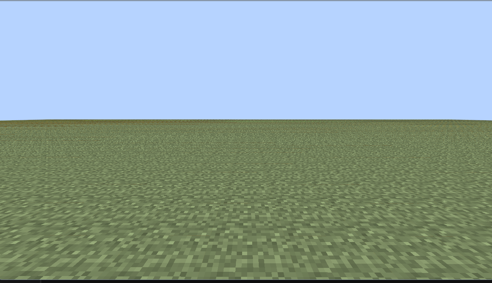

# Terraverge — Minecraft 26.3 客户端 Rust 移植

目标：以工作区内的 `minecraft-26.3-client-src`（26.3，协议 777，资源包 97.1）
为**唯一行为基准**，把客户端逐包、逐类移植到 Rust。渲染后端固定为现有的
`ash` Vulkan 实现，尽量不引入新的第三方库。

> 这不是“做一个像 Minecraft 的游戏”，而是“把 Minecraft 26.3 的客户端逻辑
> 用 Rust 重写一遍”。类名、字段语义、常量、数据格式和加载顺序都以 Java
> 源码为准；允许的差异必须记录在 [DECISIONS.md](DECISIONS.md)。

## 当前状态（2026-11-21）

已经打通第一个**可运行的垂直切片**：

- 直接读取 26.3 解包资源：资源管理器、`en_us` 语言（8559 键）、
  方块状态/模型 JSON、PNG 图集；
- 从真实 `blockstates`/`models` 烘焙首批 7 个方块的全部状态；
- 81 个区块的平坦世界（`FlatLevelSource` 占位实现），44,352 个可见四边形；
- Vulkan 渲染：最近邻采样图集、深度测试/MSAA、天空色清屏；
- 第一人称玩家：鼠标视角、WASD、潜行、疾跑、跳跃、方块 AABB 碰撞；
- 48 个单元测试覆盖数学、标识符、JSON、状态展开、模型烘焙、网格构建。

实测启动日志：

```text
世界: 81 个区块，出生点 ((8.5, -60, 8.5)), 网格 177408 顶点 / 44352 四边形，
图集 48x48 (9 张)，语言 8559 键
发现设备："NVIDIA GeForce RTX 3050 Laptop GPU"，类型：DISCRETE_GPU
窗口已创建: 1280x720
```



距离“完整客户端”仍很远：Java 侧有 7301 个文件，当前移植了约 45 个类的
核心行为。已实现/待实现清单见 [PROGRESS.md](PROGRESS.md)。

## 快速开始

前置条件：

- Rust stable（edition 2024）；
- 支持 Vulkan 1.2+ 的 GPU（当前在 Windows + NVIDIA 上验证）；
- 已解包的 `minecraft-26.3-client-src` 位于仓库根目录（默认路径）。

```bash
# 构建并运行
cargo run -p game

# 只做检查与测试
cargo check --workspace
cargo test --workspace
```

资源目录查找顺序：

1. 环境变量 `TERRAVERGE_CLIENT_ROOT`；
2. `crates/game/../../minecraft-26.3-client-src`（工作区默认布局）；
3. 当前目录及所有祖先目录下的 `minecraft-26.3-client-src`。

```bash
TERRAVERGE_CLIENT_ROOT=/path/to/extracted/client cargo run -p game
```

## 操作

| 输入 | 行为 |
| --- | --- |
| 鼠标移动 | 转动视角（启动后自动锁定鼠标） |
| W / A / S / D | 前进 / 左移 / 后退 / 右移 |
| 空格 | 跳跃（着地时） |
| 左/右 Shift | 潜行速度 |
| 左/右 Ctrl + W | 疾跑 |
| 左键点击窗口 | 重新锁定鼠标 |
| Esc | 退出（暂停菜单尚未移植） |

## 工作区结构

```text
crates/
├── base/                 数学库出口（glam）
├── window/               winit 薄封装：窗口、键鼠、光标捕获
├── render/
│   └── render_backend/ren_vulkan/   ash Vulkan 后端
├── minecraft/            Minecraft 26.3 一比一移植（无 GPU 依赖）
└── game/                 启动器与胶水层（当前主程序）
```

`minecraft` crate 内部严格镜像 Java 包路径，例如：

```text
Java: minecraft-26.3-client-src/net/minecraft/core/BlockPos.java
Rust: crates/minecraft/src/net/minecraft/core/block_pos.rs
```

## 文档索引

| 文档 | 内容 |
| --- | --- |
| [PORTING.md](PORTING.md) | 移植规则：命名、重载、继承、所有权、异常、静态初始化 |
| [ARCHITECTURE.md](ARCHITECTURE.md) | crate 依赖、资源→网格→Vulkan 数据流、启动时序 |
| [ASSETS.md](ASSETS.md) | 资源包格式、模型/UV/图集算法、已知采样细节 |
| [PROGRESS.md](PROGRESS.md) | 逐包统计、已移植类清单、下一步路线图 |
| [DECISIONS.md](DECISIONS.md) | 架构决策记录（ADR）与允许的偏差 |

## 重要边界

- 当前只读取解包目录，不读 `.jar`/zip，不做资源包优先级与异步重载；
- 世界生成是固定四层平地，仅用于贯通渲染链路，不代表 26.3 的完整
  `FlatLevelSource`/生物群系/结构系统；
- 尚无 GUI、字体、音效、多人网络、实体、光照、方块更新、区块异步编译；
- 传送门、命令、配方、进度等更高层系统完全未开始。

这些边界在下述文档中都有对应的待办项，避免把“能跑”误当成“移植完成”。
